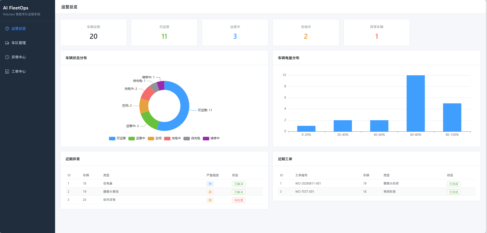
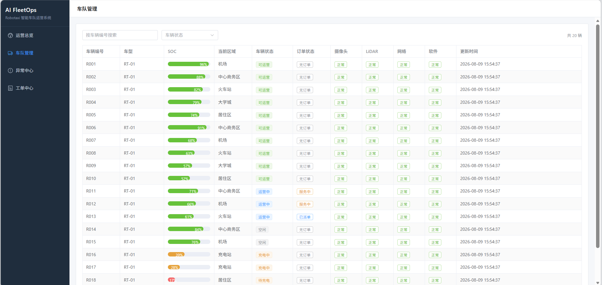
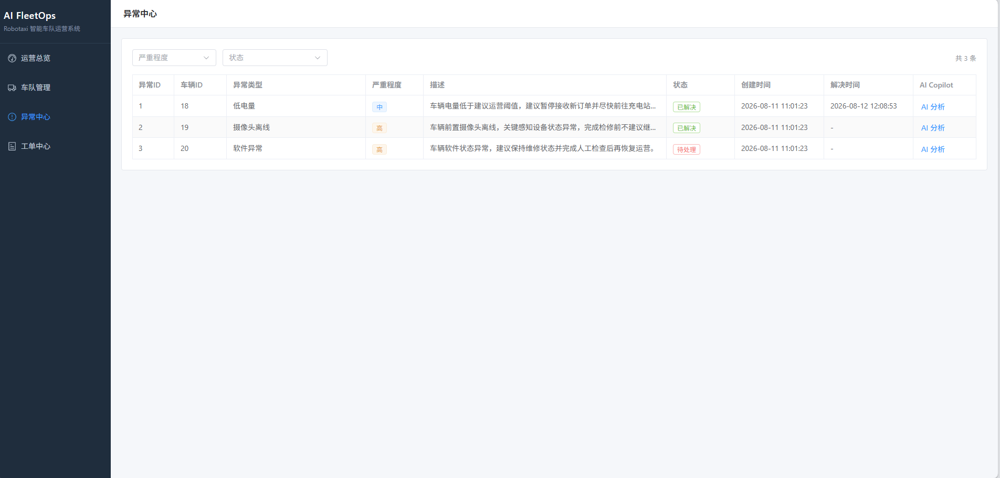
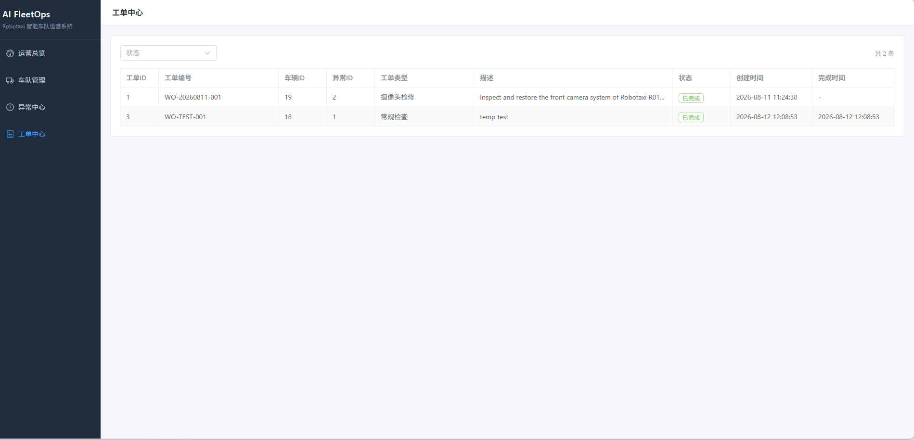

# AI FleetOps

一个自己持续开发的 Robotaxi 车队运营项目。

我没有一开始就直接做 AI 功能，而是先在 V0.1 把车辆、异常事件、维修工单和运营看板等基础业务跑通，先建立一套可以继续扩展的数据和业务流程。

目前 V0.1 已完成，正在开发 V0.2 AI Incident Copilot，尝试接入阿里云百炼 / Qwen API，为具体异常事件提供 AI 辅助分析。

## 当前进度

* V0.1：车队基础运营后台，已完成
* V0.2：AI Incident Copilot，开发中
* 后续：考虑继续加入 RAG、Tool Calling 和 Human-in-the-loop

目前仓库中的 AI 功能仍处于开发阶段，没有把后续规划功能当成已经实现的功能展示。

---

## 项目截图

### 运营总览



### 车队管理



### 异常中心



### 工单中心



---

## V0.1 做了什么

V0.1 的目标主要是先把 FleetOps 的基础业务搭起来。

目前包含：

* 运营 Dashboard
* Robotaxi 车辆管理
* Incident 异常事件管理
* Work Order 维修工单管理
* Vehicle 状态管理
* Device Status 独立更新
* 前后端 REST API
* Incident / Work Order 状态流转

项目里做了一条比较完整的异常处理流程：

```text
Camera OFFLINE
      ↓
Incident Created
      ↓
PENDING_APPROVAL
      ↓
PROCESSING
      ↓
Create Work Order
      ↓
Work Order COMPLETED
      ↓
Incident RESOLVED
      ↓
Camera NORMAL
      ↓
Vehicle READY
```

主要是模拟 Robotaxi 运营过程中出现设备异常后，从发现问题、创建异常事件、生成维修工单，到最终恢复车辆状态的一整套流程。

---

## 技术栈

* 后端：Java、Spring Boot、MyBatis-Plus、MySQL
* 前端：Vue 3、Vite、Axios、Element Plus、ECharts
* 接口：REST API
* AI：正在尝试接入阿里云百炼 / Qwen API

目前基础结构大致是：

```text
Vue 3
  ↓
Axios / REST API
  ↓
Spring Boot Controller
  ↓
Service
  ↓
Mapper
  ↓
MySQL
```

V0.2 目前在增加：

```text
Incident / Vehicle 数据
          ↓
Incident AI Analysis
          ↓
Model Provider
          ↓
阿里云百炼 / Qwen
```

---

## 开发过程中解决的一些问题

相比只记录最终功能，我也保留了一些开发过程中实际遇到的问题。

### Vehicle 和 Camera 状态不一致

之前出现过这样的情况：

```text
Vehicle = READY
Camera = OFFLINE
```

程序本身没有直接报错，但是从业务上看状态明显不一致。

排查后发现 Vehicle 状态和设备状态不应该完全绑定在一起，所以后来增加了独立的 `/device-status` 接口，让设备状态可以单独更新。

同时还补充了部分生命周期字段：

* Incident 进入 `RESOLVED` 后自动维护 `resolvedAt`
* Work Order 进入 `COMPLETED` 后自动维护 `completedAt`

这个问题让我比较明显地意识到，代码“没有报错”不代表业务逻辑就是正确的。

### 开发环境问题

项目开发过程中还实际遇到过：

* 系统默认 JDK8，与项目要求版本不一致
* Maven 没有加入 PATH
* 8080 端口被其他进程占用
* MySQL 用户配置错误导致 Access denied
* 本地数据库配置和环境变量管理问题

这些问题基本都是通过报错信息、日志和实际运行状态逐步定位的。

---

## V0.2：AI Incident Copilot

V0.2 目前还在开发。

现阶段主要想做的是：选择一个具体 Incident 后，把这个异常事件以及相关 Vehicle 信息作为上下文提供给模型，让 AI 针对这次异常给出辅助分析。

目前计划的最小链路是：

```text
用户选择 Incident
        ↓
后端读取 Incident / Vehicle 数据
        ↓
构建分析上下文
        ↓
调用模型 API
        ↓
返回 AI 分析结果
        ↓
前端 AI 窗口展示
```

现在正在处理模型 Provider 和阿里云百炼 / Qwen API 接入。

这一阶段暂时不会直接做复杂 Agent，准备先把最基本的模型调用、业务上下文和异常处理跑通，再继续考虑 RAG 和 Tool Calling。

---

## 本地运行

### 环境

需要：

* JDK 17+
* Maven
* MySQL
* Node.js / npm

### 数据库配置

数据库用户名和密码通过环境变量读取，仓库中不保存真实密码。

Windows PowerShell 示例：

```powershell
$env:DB_USERNAME="root"
$env:DB_PASSWORD="YOUR_PASSWORD"
```

需要提前准备本地 MySQL 数据库：

```text
ai_fleetops
```

### 启动后端

如果本机 Maven 已配置到 PATH：

```bash
mvn spring-boot:run
```

后端默认：

```text
http://localhost:8080
```

### 启动前端

进入前端目录：

```bash
cd frontend
```

首次运行：

```bash
npm install
```

启动：

```bash
npm run dev
```

默认开发地址：

```text
http://localhost:5173
```

---

## 后续计划

目前优先把 V0.2 做完整：

* 跑通模型 API
* 将 Incident / Vehicle 数据作为分析上下文
* 完善模型调用异常处理
* 完善 AI 服务不可用时的降级逻辑

在基础 AI Copilot 稳定以后，再考虑：

* SOP / RAG
* Tool Calling
* Human-in-the-loop
* 天气、地图等外部数据
* 运营预测与复盘

项目会继续按版本迭代，有新的功能和问题会继续记录。
